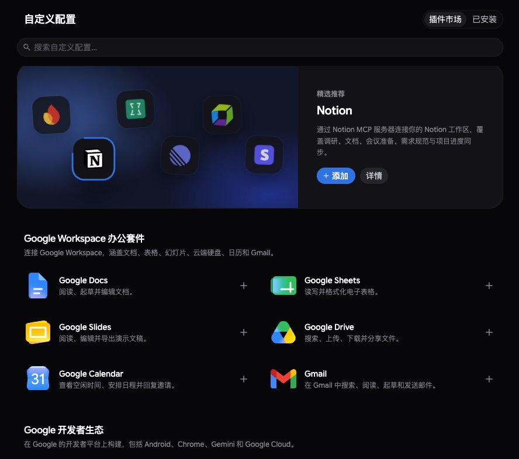

# antigravity-zh-lite

[](https://github.com/HeiHunter/antigravity-zh-lite/actions/workflows/ci-release.yml)
[](./LICENSE)
[](https://nodejs.org/)
[](#快速开始)

面向 **Google Antigravity 2.0 桌面端** 的轻量化、零第三方 npm 依赖（需 Node.js ≥ 22）、不修改安装包的简体中文汉化插件（支持 **macOS & Windows**，基于 CDP 运行时动态注入 + 开机静默常驻守护）。

---

## 效果预览

| 设置面板（常规 / 权限 / 输入框） | 自定义配置与插件市场 |
| :---: | :---: |
|  |  |

---

## 核心特性

- **极度轻量化（零 `node_modules`）**：仅依赖原生 Node.js（≥ 22），无需 `npm install`，解压或克隆即用；注入客户端的单文件内核（含完整 700+ 词库与悬浮 UI）仅 ~87 KB（gzip 后 ~27 KB）。
- **macOS & Windows 双平台开机常驻**：
  - **macOS**：一键注册 `LaunchAgent` 静默常驻 + 自动生成带官方图标的 `Antigravity 中文版.app`。
  - **Windows**：一键注册 Startup 无黑框常驻（`.vbs`）+ 自动生成带官方图标的桌面快捷方式 `Antigravity 中文版.lnk`。
  - **自动跟随接管**：即便直接从原图标打开官方 Antigravity，后台守护检测到新启动的实例后也会平滑接管并完成汉化（仅针对刚启动的实例，避免误打断已有任务）。
- **不修改安装包与签名（运行时注入）**：不改动 `Antigravity.app` / `Antigravity.exe` 及 `app.asar`，不触发 macOS 签名告警或权限重置，跨小版本更新通常无需重打补丁。
- **React 友好渲染**：仅原地替换叶子 `TextNode.nodeValue` 与安全属性（`placeholder` / `title` / `aria-label`），自动跳过代码块、终端、输入框与聊天正文，显著降低白屏与误译风险。
- **精准长句自动翻译 + 脱敏与代理自动识别**：针对无法穷举的命令审批风险说明与插件市场长简介（仅匹配 **≥ 5 词且 ≥ 28 字符** 的长句，以及 `Allow ...?` 审批标题），默认经路径/URL/命令占位符脱敏后调用 Google 翻译并做本地持久化缓存（默认上限 2000 条 FIFO，按需下发、悬停可查看英文原文）；严格拦截模型名（`Gemini` / `Claude` / `GPT`）与短标签；自动读取 macOS / Windows 系统 HTTP 代理与环境变量代理。如需纯离线静态汉化，可一键关闭动态翻译。
- **内置一键采集 & 自动上传**：右下角悬浮胶囊点击 `采集` → `结束 (N)`，通过 CDP 原生通道实时落盘到 `dicts/_collected.json`（可选配置 Webhook / GitHub Issue / Gist 自动上传）。

---

## 面对客户端更新：三层抗更新机制

传统修改 `app.asar` 的静态补丁，每次官方更新都容易失效、白屏或出现大量新功能未汉化。本插件针对 Antigravity 高频迭代设计了三层闭环：

1. **跨小版本免重打补丁**：不修改官方安装包与 `app.asar`，官方自动覆盖更新后通常可直接继续使用（若官方未来禁用调试端口或大幅重构 DOM 结构则需适配）。
2. **新长句自动适应**：新版新增的功能说明、权限审批风险提示、新上架插件介绍等长句（≥ 5 词且 ≥ 28 字符），无需更新插件即可自动翻译并缓存在本地（鼠标悬停可核对英文原文）。
3. **新短词一键采集自愈**：如果新版新增了短按钮、菜单项或修改了原有文案描述，点击右下角 **`采集`** → 逛一遍新界面 → 点击 **`结束 (N)`**，即可自动过滤噪声并导出漏译 JSON 到 `dicts/_collected.json`：
   - **本地秒级热补**：把翻译补进 `dicts/*.json`，保存瞬间客户端自动热更新生效，无需重启；
   - **一键回馈社区**：也可直接粘贴到 [词条补充 Issue](https://github.com/HeiHunter/antigravity-zh-lite/issues/new?template=dict-collect.md)，几分钟即可同步覆盖所有用户。

---

## 环境要求

- **Node.js ≥ 22.0.0**（基于原生 `WebSocket` 与 `fetch`）
  - macOS：`brew install node` 或前往 [nodejs.org](https://nodejs.org/)
  - Windows：`winget install OpenJS.NodeJS.LTS` 或前往 [nodejs.org](https://nodejs.org/)

---

## 快速开始

### 1. 获取插件（任选其一）

* **方式 A（推荐，普通用户）**：前往 [Releases 页面](https://github.com/HeiHunter/antigravity-zh-lite/releases) 下载最新 `antigravity-zh-lite-v*.zip` 并解压到本地固定目录。
* **方式 B（开发者）**：
  ```bash
  git clone https://github.com/HeiHunter/antigravity-zh-lite.git
  cd antigravity-zh-lite
  ```

### 2. 一键安装开机常驻（macOS & Windows 通用）

在插件目录执行：

```bash
node bin/ag-zh.js install
```

* **macOS**：自动注册 `LaunchAgent` 静默常驻服务，并在 `~/Applications/` 与当前目录生成 `Antigravity 中文版.app`（可拖入 Dock 替代原图标）。
* **Windows**：自动写入开机无黑框自启 `.vbs`，并在桌面与当前目录生成 `Antigravity 中文版.lnk` 快捷方式。

常用管理命令：
```bash
node bin/ag-zh.js status              # 查看常驻服务、调试端口、动态翻译与挂载窗口状态
node bin/ag-zh.js uninstall           # 卸载常驻服务与快捷启动器并即时恢复已开窗口（保留配置/缓存/日志）
node bin/ag-zh.js uninstall --purge   # 卸载并一并清理本地配置、翻译缓存、采集记录与日志
```

### 3. 临时体验（不安装开机常驻）

* **macOS**：双击 `启动汉化.command`，或终端运行 `node bin/ag-zh.js --restart`
* **Windows**：双击 `启动汉化.bat`，或终端运行 `node bin\ag-zh.js --restart`

---

## 界面操作（右下角极简胶囊）

| 操作 / 快捷键 | 功能 |
| :--- | :--- |
| 点击 `中 / EN`（或 `Option/Alt + Shift + L`） | 实时无损切换中文 / 英文原版 |
| 点击 `采集` → 浏览界面 → 点击 `结束 (N)`（或 `Option/Alt + Shift + C`） | 采集未译词条并自动保存/上传 |
| `Option/Alt + Shift + H` | 隐藏 / 显示右下角悬浮胶囊 |

---

## 进阶配置（`ag-zh.config.json`）

执行 `install` 后会在项目根目录自动生成 `ag-zh.config.json`（也可手动复制 `ag-zh.config.example.json`；若配置文件 JSON 语法损坏，守护进程会自动进入安全回退模式，暂停联网翻译、远程上传与自动接管）：

- **动态翻译数据流向与隐私保护**：默认启用 Google 翻译（仅针对未命中的 UI 长句与 `Allow ...?` 审批标题，默认缓存上限 `2000` 条 FIFO，按需从本地守护拉取）。发送前会自动对文件路径、URL、反引号命令、IP、邮箱等敏感片段进行占位符脱敏，若译文破坏占位符则自动丢弃并保留原文；**不会**静默回退到第三方 MyMemory 服务，配置 `openai` / `gemini` 失败时也**不会**静默改走免费接口。如需纯离线静态汉化，将 `dynamicTranslate.enabled` 设为 `false` 即可。
- **自定义代理（可选）**：默认自动读取环境变量与 macOS / Windows 系统 HTTP 代理；如需手动指定，填写 `dynamicTranslate.proxy`（例如 `"http://127.0.0.1:7890"`）。
- **大模型动态翻译（可选）**：将 `dynamicTranslate.provider` 设为 `"gemini"` 或 `"openai"`，并填写 `apiKey` / `model` / `apiBaseUrl`（如需显式使用 MyMemory 可手动设为 `"mymemory"`）。
- **采集自动上传（可选）**：`upload.mode` 支持 `"local"`（默认仅落盘 `dicts/_collected.json`，不触发远程请求）、`"webhook"`、`"github-issue"`、`"github-gist"`。
- **自定义调试端口与客户端路径**：新安装默认使用 CDP 端口 `19229`（已有旧配置中的 `9229` 会继续沿用，无需手动迁移）；若 Antigravity 未安装在默认目录，可在 `app` 字段填入实际路径（macOS `.app` 或 Windows `.exe`）。

---

## 常见问题（FAQ）

**Q：是否会修改 Antigravity 安装包或破坏 macOS 签名？**  
A：不会。本插件通过 Chromium DevTools Protocol（CDP）在运行时向 Antigravity 顶层 UI 页面注入轻量脚本，不触碰任何官方二进制文件或 `app.asar`。执行 `uninstall` 会移除常驻服务与快捷启动器，并尝试即时将已打开窗口切回英文；默认保留本地配置、缓存与日志（如需彻底清理可运行 `uninstall --purge`），重启客户端后调试端口自动关闭。

**Q：开启 `--remote-debugging-port=19229` 安全吗？**  
A：Chromium 的远程调试端口默认仅绑定在本地回环地址 `127.0.0.1`，不对外网开放。守护进程会校验端口身份并严格限定仅注入 Antigravity 顶层 UI 窗口（不注入子 iframe、DevTools 或普通本地开发预览页）。如需更改端口，可在 `ag-zh.config.json` 修改 `port` 后重新执行 `install`。

**Q：Antigravity 客户端自动升级后汉化会失效吗？**  
A：常规版本升级通常无需重新打补丁。由于不修改官方安装包，官方覆盖更新不会破坏本插件运行；若新版出现全新英文文案，长句可自动走动态翻译，短标签可点击右下角「采集 → 结束」快速补充（若官方未来禁用 CDP 调试端口或大幅改版 DOM 结构，则需等待插件适配更新）。

**Q：为什么需要 Node.js ≥ 22？**  
A：为了做到零第三方 npm 依赖（0 `node_modules`），本插件直接使用 Node 22+ 原生内置的 `WebSocket` 与 `fetch`。

---

## 参与贡献

欢迎通过 [提交词条 Issue](https://github.com/HeiHunter/antigravity-zh-lite/issues/new?template=dict-collect.md) 或直接向 `dicts/*.json` 提交 Pull Request 来完善翻译，详见 [CONTRIBUTING.md](./CONTRIBUTING.md)。

```bash
npm run validate      # 校验 dicts/*.json 语法、重键与正则合法性
npm run build         # 构建 dist/injector.js 与 dist/dict.json
npm test              # 运行全部自动化单元测试
npm run pack:release  # 自动过滤本地隐私缓存，生成干净的分发压缩包
```

---

## 免责声明

本项目为社区维护的第三方本地化辅助工具，与 Google 或 Antigravity 官方无任何从属关系。按 [MIT License](./LICENSE) 开源提供，请按需使用。
